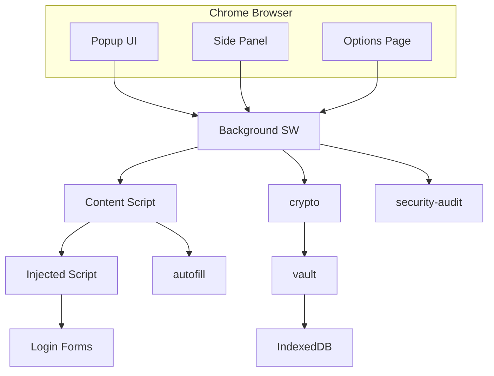
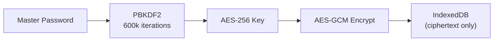

# Password Manager — Architecture

## Overview

Password Manager is a zero-knowledge Manifest V3 Chrome extension. All encryption happens client-side using the Web Crypto API. The server (sync backend, Module 10) never sees plaintext credentials.

## Context Diagram

## Security Architecture

## Extension Contexts

| Context | Purpose |
|---------|---------|
| Background SW | Vault lock state, autofill routing, sync queue |
| Content Script | Form detection, secure field filling |
| Injected Script | Page-world form scanner (Shadow DOM, iframes) |
| Popup | Unlock vault, generate password, quick autofill |
| Side Panel | Browse credentials, security audit results |
| Options | Sync config, auto-lock, security settings |

## Package Boundaries

| Package | Module | Responsibility |
|---------|--------|---------------|
| `@pwm/crypto` | 2 | PBKDF2, AES-GCM, SHA-256 |
| `@pwm/vault` | 3 | Encrypted credential storage |
| `@pwm/generator` | 4 | CSPRNG password generation |
| `@pwm/security-audit` | 5 | HIBP, reuse, weak password detection |
| `@pwm/autofill` | 6–7 | Form detection + origin validation |
| `@pwm/webauthn` | 8 | Passkey registration/authentication |
| `@pwm/totp` | 9 | RFC 6238 TOTP generation |
| `@pwm/sync` | 10 | E2E encrypted sync + offline queue |

## Key Design Decisions

- **Web Crypto API only:** No third-party crypto libraries — uses browser-native primitives
- **Zero-knowledge:** Master password → PBKDF2 → AES key; password never persisted
- **Origin-locked autofill:** Credentials only fill on exact origin match — prevents phishing
- **In-memory vault:** Decrypted data exists only while vault is unlocked; cleared on lock/timeout
- **HIBP k-anonymity:** Only first 5 chars of SHA-1 hash sent to API — password never transmitted

## Threat Model (STRIDE Summary)

| Category | Threat | Mitigation |
|----------|--------|-----------|
| Spoofing | Fake login page | Origin validation + homograph detection |
| Tampering | Modified vault data | AES-GCM authentication tags |
| Repudiation | Denied autofill action | Local audit log |
| Information Disclosure | Memory dump | Auto-lock, key clearing |
| Denial of Service | Vault corruption | Checksum validation, backup |
| Elevation of Privilege | XSS in content script | CSP, no eval, minimal permissions |
