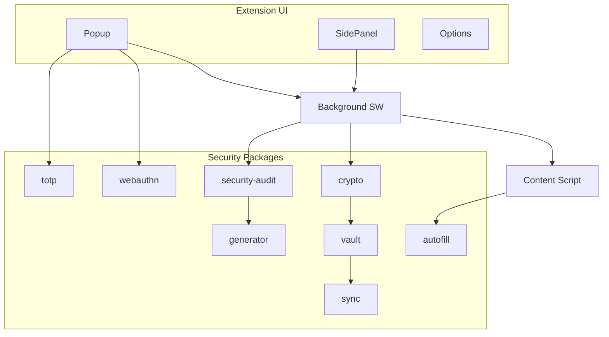

# Password Manager — Roadmap

> Zero-knowledge password manager Chrome extension with encrypted vault, autofill, TOTP, and WebAuthn passkey support.

## Tech Stack

| Category | Technology |
|----------|-----------|
| Language | TypeScript 5 (strict) |
| Framework | React 19 |
| Build | Vite + CRXJS |
| Monorepo | Turborepo + pnpm |
| Crypto | Web Crypto API (AES-256-GCM, PBKDF2) |
| Database | IndexedDB / Dexie (Module 3) |
| Auth | WebAuthn / FIDO2 (Module 8) |
| Testing | Vitest + Playwright |
| CI | GitHub Actions |

**Duration:** 6–7 weeks · **Difficulty:** ⭐⭐⭐⭐⭐

---

## Phase 1 — Security Foundation

### Module 1 — Extension Setup ✅

**Version:** v0.1 · **Duration:** 3 days

| Deliverable | Status |
|-------------|--------|
| Turborepo monorepo | ✅ |
| MV3 manifest | ✅ |
| Background service worker | ✅ |
| Content + injected scripts | ✅ |
| Popup, side panel, options | ✅ |
| Domain packages (stubs) | ✅ |
| ESLint, Prettier, Husky, CI | ✅ |

**Resume:** Built a production-ready MV3 extension architecture with security-focused package boundaries and CI/CD.

---

### Module 2 — Cryptography

**Version:** v0.2 · **Package:** `@pwm/crypto` · **Duration:** 5 days

**Learn:** AES-256-GCM, PBKDF2, Argon2, SHA-256, salt, IV, authentication tags

**Build:** Key derivation, encrypt/decrypt, constant-time comparison, secure memory handling

**Resume:** Implemented a zero-knowledge encryption core using PBKDF2 and AES-256-GCM with secure key derivation.

---

### Module 3 — Vault Engine

**Version:** v0.3 · **Package:** `@pwm/vault` · **Duration:** 5 days

**Learn:** IndexedDB, Dexie, repository pattern, encryption-at-rest

**Build:** Encrypted vault, folders, tags, attachments, auto-lock

**Resume:** Built an encrypted vault storing credentials, notes, and attachments with IndexedDB.

---

## Phase 2 — Password Intelligence

### Module 4 — Password Generator · `@pwm/generator`

CSPRNG, Diceware, entropy calculation, strength meter.

**Resume:** Built a CSPRNG password generator with entropy-based strength assessment.

### Module 5 — Security Scanner · `@pwm/security-audit`

HIBP k-anonymity, reuse detection, weak password audit, expiration alerts.

**Resume:** Built a local security audit detecting reused and compromised credentials using k-anonymity.

---

## Phase 3 — Autofill

### Module 6 — Form Detection · `@pwm/autofill`

Shadow DOM, SPA navigation, iframe support, heuristic field matching.

**Resume:** Developed a universal form detection engine supporting SPAs, iframes, and Shadow DOM.

### Module 7 — Secure Autofill

Origin matching, anti-phishing, homograph/IDN detection, strict permissions.

**Resume:** Implemented phishing-resistant autofill with strict origin validation and IDN protection.

---

## Phase 4 — Authentication

### Module 8 — WebAuthn · `@pwm/webauthn`

Passkeys, FIDO2, platform authenticator, encrypted credential storage.

**Resume:** Added WebAuthn-based passkey support with encrypted credential storage.

### Module 9 — TOTP · `@pwm/totp`

RFC 6238, QR parsing (otpauth://), backup codes, clipboard with auto-clear.

**Resume:** Implemented a standards-compliant TOTP authenticator compatible with major MFA providers.

---

## Phase 5 — Synchronization

### Module 10 — Sync Engine · `@pwm/sync`

End-to-end encrypted sync, conflict resolution, device trust, offline queue.

**Resume:** Designed an end-to-end encrypted synchronization architecture with conflict resolution and offline support.

---

## Phase 6 — Security Engineering

### Module 11 — Threat Modeling

STRIDE analysis, OWASP review, attack surface mapping, penetration testing checklist.

**Resume:** Produced a comprehensive STRIDE threat model and security review for a browser-based password manager.

### Module 12 — Production Release

Chrome Store, Firefox port, security audit, performance benchmarks, documentation.

---

## Architecture

## Git Milestones

| Tag | Module |
|-----|--------|
| v0.1 | Extension foundation |
| v0.2 | Cryptography |
| v0.3 | Vault engine |
| v0.4 | Password generator |
| v0.5 | Security scanner |
| v0.6 | Form detection |
| v0.7 | Secure autofill |
| v0.8 | WebAuthn |
| v0.9 | TOTP |
| v0.10 | Sync engine |
| v1.0 | Production release |

## Interview Topics

- Zero-knowledge architecture — server never sees plaintext
- PBKDF2 vs Argon2 for key derivation
- Why AES-GCM over AES-CBC
- HIBP k-anonymity model
- WebAuthn vs TOTP trade-offs
- STRIDE threat modeling for browser extensions
- Homograph attack prevention in autofill

## Threat Model Summary (Module 11)

| Threat | Mitigation |
|--------|-----------|
| Master password theft | PBKDF2 600k iterations, never stored |
| Vault data breach | AES-256-GCM encryption-at-rest |
| Phishing | Strict origin validation + homograph detection |
| XSS in content script | Minimal privileges, no eval, CSP |
| Memory dump | Lock vault, clear keys from memory |
| Sync interception | E2E encrypted, device trust keys |
